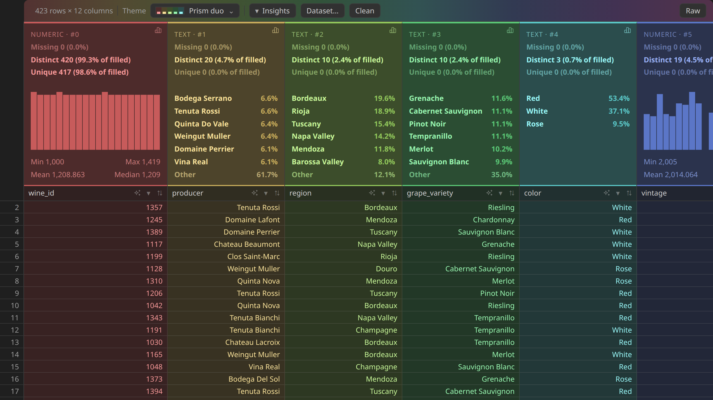
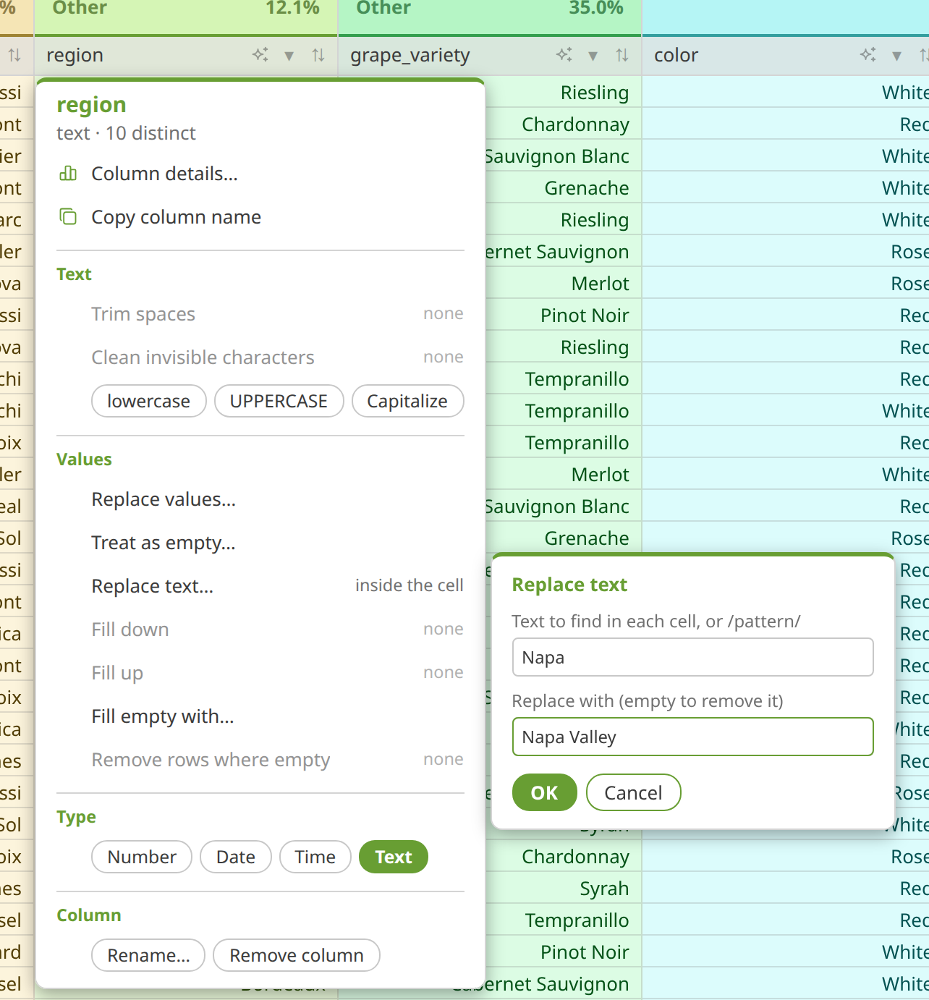
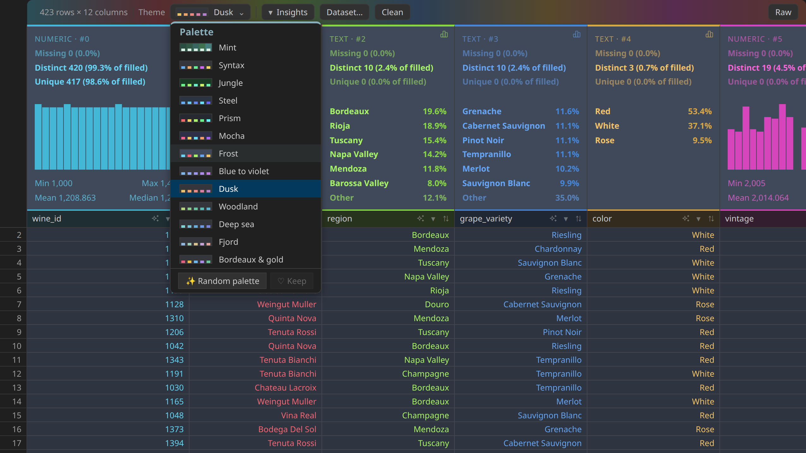
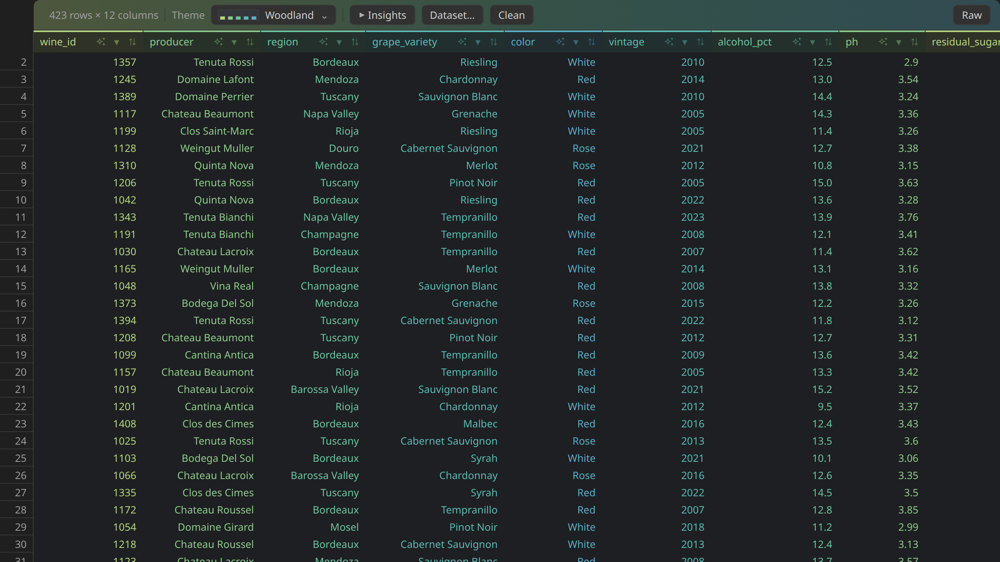
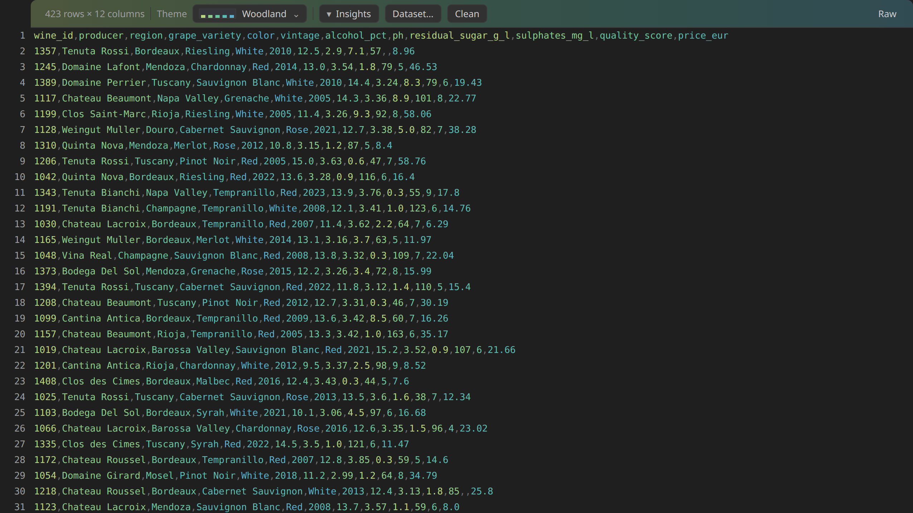

# CSV Stats

**See what's in a CSV, clean it, and load it into pandas.** Per-column
statistics, one-click cross-filtering, cleaning steps that never touch the
original, and a `pd.read_csv` call that matches what is really in the file —
separator, decimal comma, missing-value tokens, dates.

Right-click a `.csv` file in the explorer → **Open in CSV Stats**.



*A band above every column: type, missing, distinct and unique values, then a histogram or the most frequent values.*

## What's new

- **Correlation heatmap** (0.31). *Dataset* has a *Heatmap* button: every pair of numeric
  columns on one grid, red when they rise together, blue when one falls as the other
  rises, with the seaborn code to copy. Its section titles now line up on the left, in bold,
  with a small icon, like the column menu.
- **Clean what is inside the cells** (0.30). *Replace text…* finds a piece of text in each
  cell (`€`, `kg`) or a pattern written `/like this/`; *Fill up*, and *Fill empty with…* a
  fixed value, join *Fill down*. The field you type in unfolds right beside the menu.
- **Remove the rows you are looking at** (0.30). With a filter on — outliers, a value, a
  spelling — *Remove these N rows* takes them out of the cleaned table, as a step you can undo.
- **More real files open** (0.30). Tab and `|` separators, and files saved by Excel in
  Windows-1252 or UTF-16, are read correctly. Tooltips are instant, and clicking again
  closes a menu or field.
- **Spelling, encoding, gaps** (0.27). *Merge* similar spellings (`Lyon`, `Lyons`, `lyon `)
  from the column's menu or *Clean*; fix garbled characters (`Café` → `Café`); see where
  an id or date series has holes; and read a measure's **average by category**.
- **Column details tells what is wrong** (0.26). Placeholder values (`-999`, `1900-01-01`) with
  *Treat as empty* beside them, the column **in row order** with its outliers and empty
  cells, repeated values in an identifier column, advice for pandas (`Int64`, `category`…),
  and **related columns** in *Dataset*.
- **Column details leads to the fix** (0.25.1). Outliers, values that break the
  column's type and inconsistent formats (`A-9999` against `A-999`) are one click
  from their rows, with the cleaning step that fixes them right beside.
- **Clean, without touching the original** (0.25.0). A sparkle icon on every column
  header (or right-click it) trims, fixes case, replaces values, changes the
  type, renames or removes the column; the **Clean** button lists the applied
  steps, holds the full catalogue — duplicate and blank rows included — and
  saves a cleaned copy next to the file, `name.clean.csv`, never over it.
  Changed cells are underlined; hover one to see what it was.
- **Duplicated rows, side by side** (0.24.4). Every occurrence, original
  included, grouped one under the other on alternating shades of the palette;
  hover a row number to see where the others are.
- **Findings in colour** (0.24.4). Each finding in *Dataset* wears its column's
  colours, so you see at once where to clean.
- **Unique values** (0.24.3). Next to *Distinct*, the count of values that occur only
  once — often typos hidden under *Other*. Click it to see those rows.
- **Dates and times** (0.24.3). `2015-01-31`, `31/01/2015` and `12:52:01` are recognised:
  a timeline instead of a ranking, a chronological sort, a *before / after /
  between* filter, and `parse_dates` in the generated pandas code.
- **Fixes** (0.24.3). A column no longer changes type under a filter, and *Read this
  column as* now applies to the filtered rows and survives later filters.
- **Headers in colour** (0.30). With *Dusk* and *Woodland*, and in about half the random
  palettes, each column name wears its column's colour, adjusted to stay readable.
- **Random palettes, much more varied** (0.29). *Random palette* draws coloured text, on a
  plain background or on one veiled with each column's colour, with or without grid lines,
  and over the whole colour wheel instead of mostly blues and violets.
- **Palettes and headers** (0.28). Six palettes — four *tone on tone*, where one family of
  colour glides from column to column, and two with distinct colours — and a column header
  that wears its column's colour: a rule on top, a light veil behind.

Every version is listed in the [changelog](https://github.com/gcapellib/vscode-csv-stats/blob/main/CHANGELOG.md).

## Features

- **Statistics per column** — type (number, date, time or text), missing,
  distinct and unique values, histogram, min / max, mean / median.
- **Cross-filtering** — click a bar or a value: the table keeps those rows and
  every other band is recomputed on them. Filters show as chips; one click
  removes each.
- **Filter panel per column** — a value list with search, like Excel; *contains*
  / *starts with* for text; *greater than* / *between* for numbers and dates.
- **Cleaning steps** — trim, invisible characters, case, replace values or text
  inside a cell (plain or regular expression), treat tokens as empty, fill down,
  fill up, fill empty cells with a value, change type, rename, remove a column,
  remove duplicate, blank or filtered rows (outliers included). Each step shows what it changed and can be removed;
  the original is never modified, and every save keeps a new copy.
- **Column details** — the chart button on each band: empty cells, cells of spaces and `NULL` counted apart,
  placeholder values, the distribution and the column in row order, outliers, formats, gaps in a
  series, average by category, what pandas would make of the column and what stands in the way.
- **Dataset** — the matching `pd.read_csv`, followed by every rename, drop,
  filter and sort you made, in order — plus duplicated rows and values that
  differ only by case or padding, each one click away.
- **Correlation heatmap** — one click on *Heatmap*, in *Dataset*, draws the Pearson
  correlation of every pair of numeric columns; hover a cell for the coefficient,
  copy the matching seaborn code.
- **Raw view** — the file exactly as written, each field in its column's colour.
- **20 palettes**, and random ones to draw —
  hover to preview on your own data.
- **Fast** — 100,000 rows scroll smoothly; the file itself is never modified.



*Right-click a header: the cleaning steps for that column, and the field they need unfolds right beside the menu.*



*Hover a palette and the sheet changes at once; only a click keeps it.*



*Fold the bands and every column narrows to its values: twelve columns on screen.*



*Raw: the unparsed file, each field still in its column's colour.*

## Good to know

- Comma, semicolon, tab and `|` files; in a semicolon file the comma is a decimal
  separator. UTF-8, Windows-1252 (what Excel writes) and UTF-16 are recognised, and
  the generated `pd.read_csv` says which.
- Up to 300 MB; beyond 500,000 rows only the first 500,000 are analysed, and the
  tab says so.
- How every part works, and why: the [guide](https://github.com/gcapellib/vscode-csv-stats/blob/main/docs/guide.md).

## Install

Extensions view → `…` → **Install from VSIX…**, or:

```bash
code --install-extension csv-stats-0.25.8.vsix
```
